# Procedural Building Generator (`procbuild`) — Architecture & Render Showcase

A rule-driven, headless-capable procedural 3D building generator for **Blender**, designed to produce game-ready architectural structures, interiors, trim-sheet UV layouts, colliders, and **Enfusion / Arma Reforger** export pipelines.

> **Note:** This repository is a **documentation and render showcase** only. The `procbuild` source code, asset libraries, and mod-making rules are kept private.

---

## Headless Blender Renders

Generated directly from parametric presets in headless Blender 5.2:

| Apartments (`abandoned_apartments`) | Hotel (`americana_main_hotel`) | Theater (`americana_main_theater`) |
|---|---|---|
| 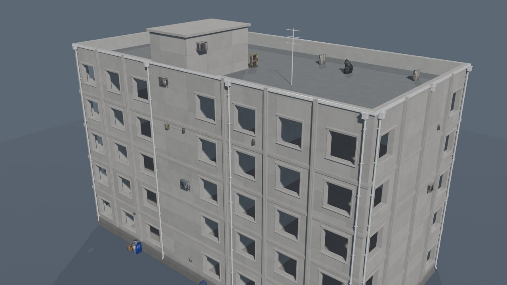 | 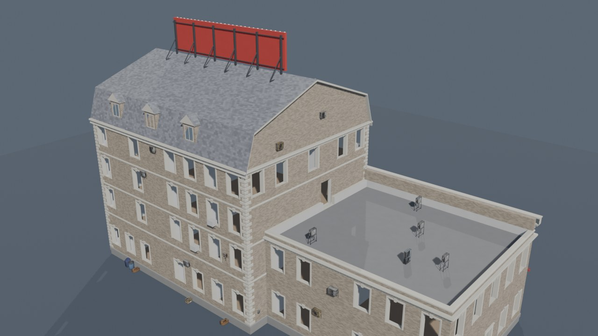 | 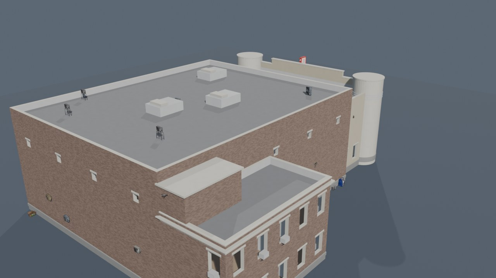 |

| Chongqing Skybridge Towers (`chongqing_skybridge_towers`) | Fujian Tulou (`chinese_tulou_round_3`) | Normandy Timber Manor (`normandy_manor_timber_manor`) |
|---|---|---|
| 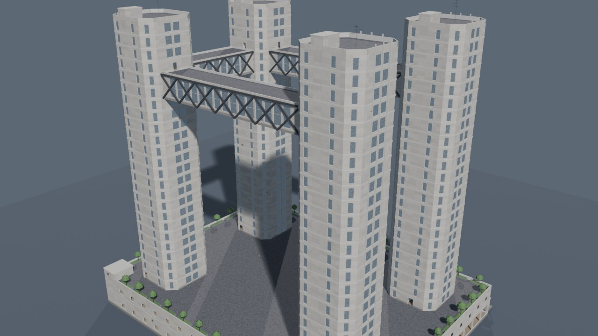 | 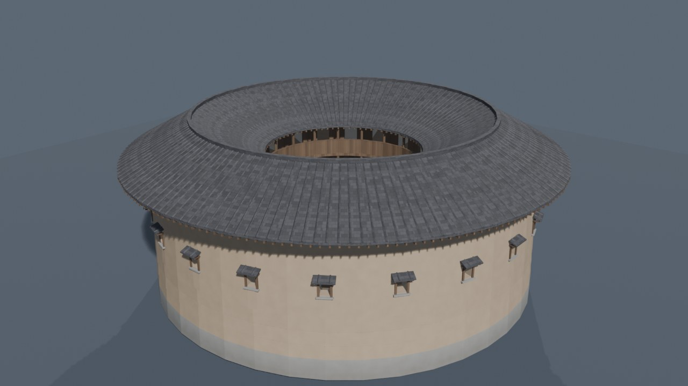 | 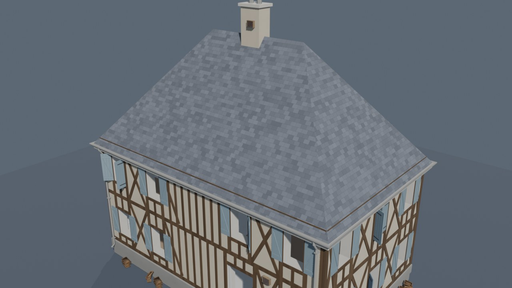 |

| Flak Tower (`wehrmacht_flak_tower`) | Diagrid Tower (`london_gherkin_tower`) | Roadside Diner (`americana_road_diner`) |
|---|---|---|
| 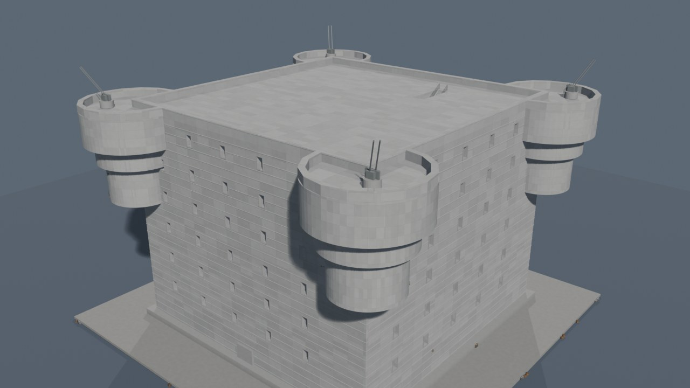 | 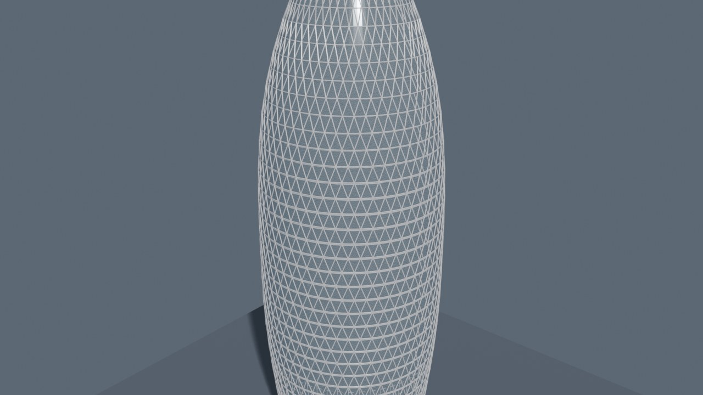 | 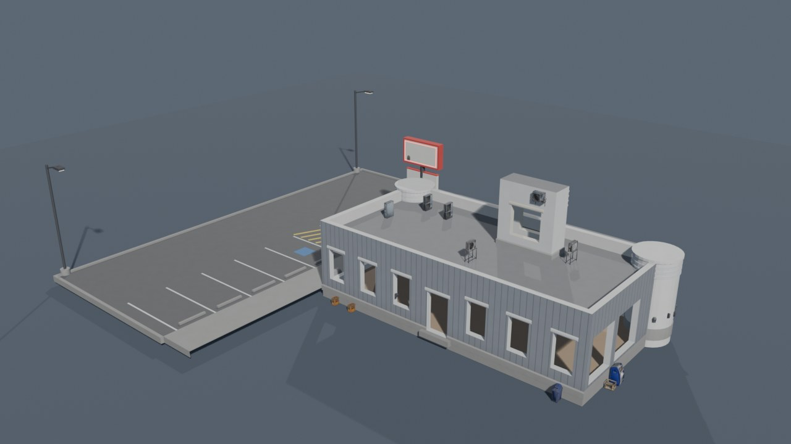 |

### Parametric Destruction & Rubble (`washington_capitol`)

| Intact | Damaged (`ruin="BITE"`, shell holes & rubble apron) |
|---|---|
| 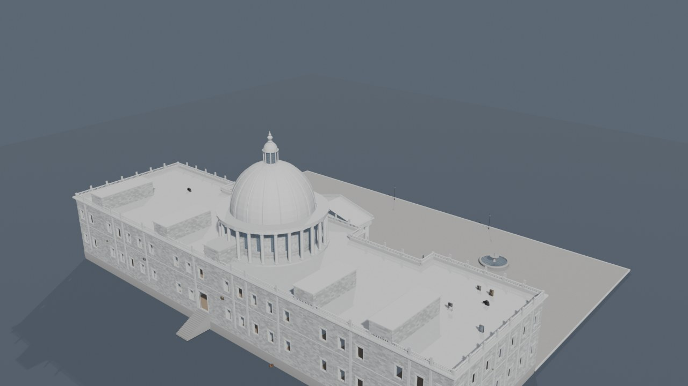 | 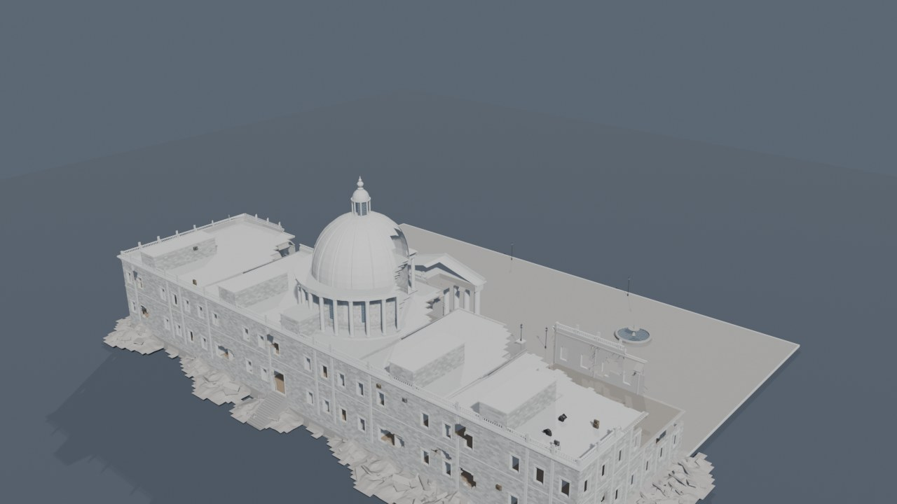 |

---

## Architecture Overview

`procbuild` cleanly separates **pure-Python procedural geometry & layout** (`procbuild/core/`) from the **Blender `bpy` adapter** (`procbuild/blender/`), keeping the core architectural grammar deterministic, testable, and independent of Blender's UI.

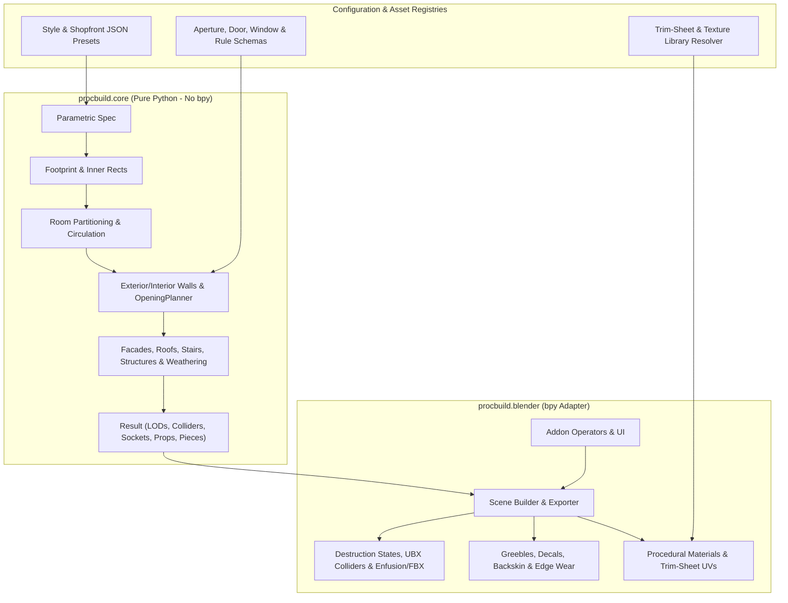

### Modular Style Generators (`procbuild.core`)

Beyond standard corridor and grid buildings, the core engine supports modular architectural grammar pipelines that all emit the same unified `Result` contract:

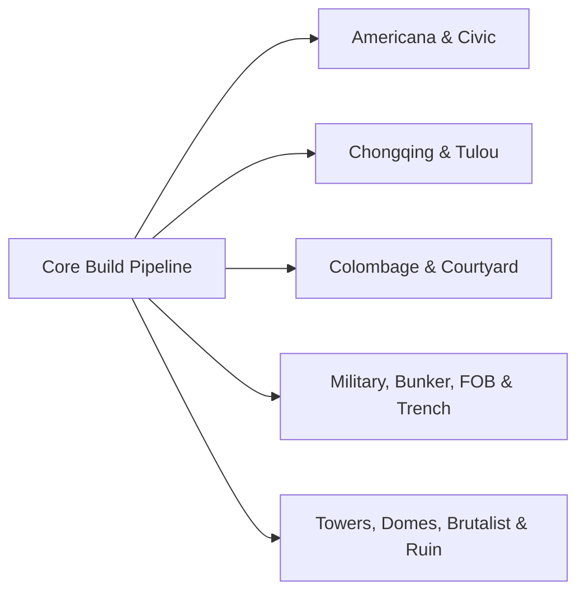

---

## Key Engineering Highlights

- **Pure-Python Core vs. `bpy` Adapter:** Geometry generation, room partitioning, opening placement, and collider extraction run in pure Python, allowing 120+ automated structural/layout unit tests to execute outside Blender.
- **Parametric Destruction (`ruin`):** Supports `BITE`, `SHELL`, `CROWN`, `FRAME`, `LEAN`, and `PANCAKE` damage modes—cutting walls, floor slabs, facades, and colliders together while generating rebar, hanging slabs, shell holes, and rubble aprons.
- **Game-Engine Ready:** Emits multi-LOD meshes, greedy-merged `UBX` / convex-hull colliders, attachment sockets, and trim-sheet UV layouts tailored for **Enfusion / Arma Reforger**.
- **Headless Automation:** Full CLI/headless Blender support for batch generation, structural validation, and automated preview rendering.
